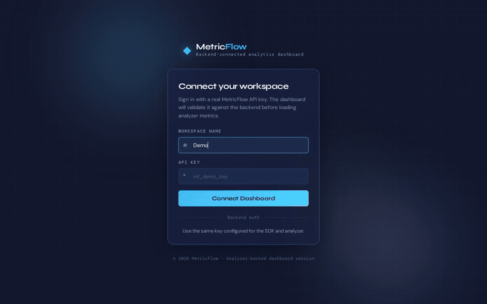
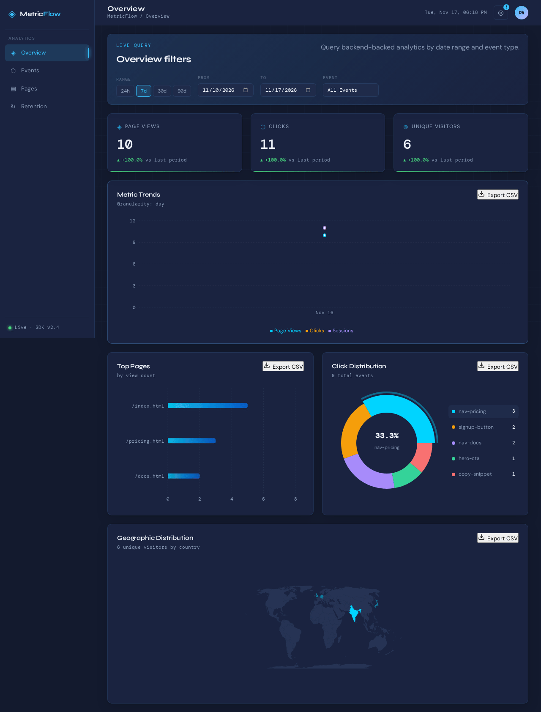
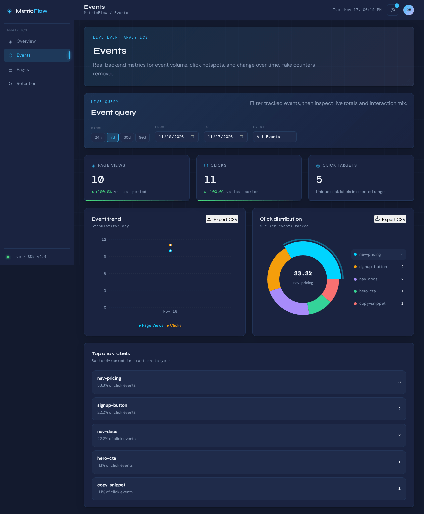
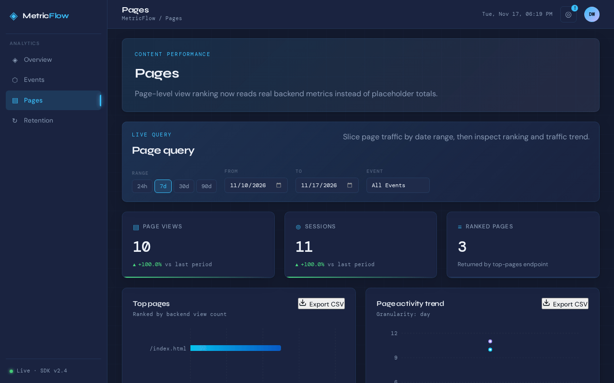
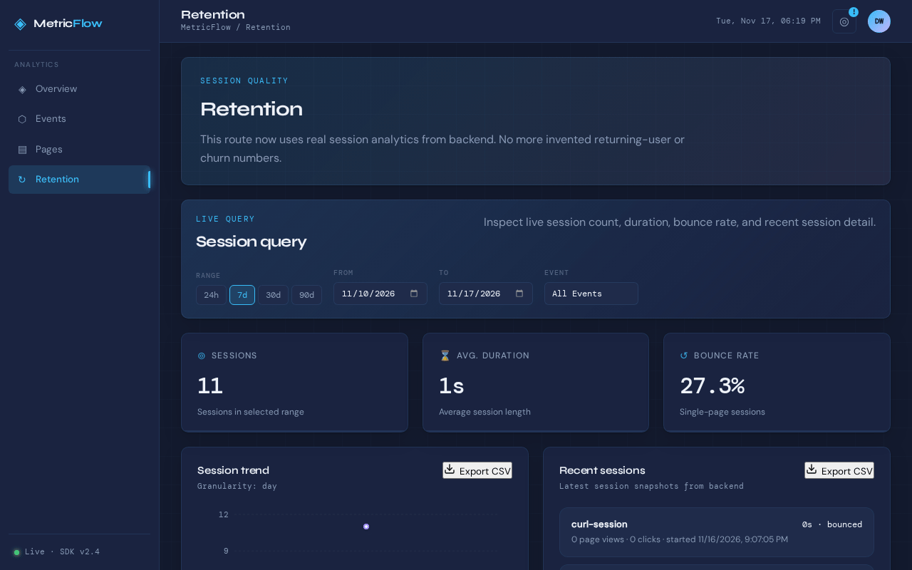

# MetricFlow (analytics-tracker)

MetricFlow is a small website analytics system: a tracking script you embed in a site, an ingestion API that stores raw events in MongoDB, a Python worker that turns them into summary metrics, and a dashboard that shows the results. It was built as a four-person team project.

**Status: unfinished.** The full loop works locally (SDK to API to MongoDB to analyzer to dashboard), but session tracking is broken, some analyzer output is thrown away, and auth is a placeholder. The [What works and what doesn't](#what-works-and-what-doesnt) section lists what was checked by running it.



*Dashboard reading real data from a local run: five scripted visitors browsed a three-page stand-in site with the SDK embedded, then the analyzer ran once. Recorded with a local MongoDB in Docker and the default demo key `mf_demo_key`.*

## How it works

Only the backend talks to MongoDB. The SDK posts events to `POST /api/v1/events`, the analyzer reads raw events from `GET /api/v1/analyzer/events` and writes results to `POST /api/v1/analyzer/summaries`, and the dashboard reads `GET /api/v1/metrics/*`. Every call carries an `x-api-key` header.

- **SDK** (`apps/sdk/src/index.ts`): a drop-in script built to `apps/sdk/dist/metricflow.js` and served by the backend at `/mf.js`. Configured from `data-mf-*` attributes on its script tag. It tracks page views (including single-page-app route changes), clicks with the element's id, text and tag, and custom events through `mf("track", name, properties)`, with optional scroll and performance tracking. Each event carries a visitor id (localStorage), session id (sessionStorage), URL, user agent, viewport, time zone and locale; the country is guessed from the time zone or locale.
- **Backend** (`services/backend`): Express, Mongoose and zod. `POST /api/v1/events` and `/events/batch` validate and store events in `events_raw` with a TTL (`EVENTS_TTL_DAYS`). `/api/v1/analyzer/*` hands raw events to the analyzer and stores its summaries in `metric_summaries`. `/api/v1/metrics/*` serves overview, time series, top pages, top elements, geo and session metrics; the overview uses the newest analyzer summary when there is one and falls back to counting raw events. Country comes from CDN headers such as `cf-ipcountry` when present, otherwise from the event's time zone or locale (`src/lib/geo.ts`).
- **Analyzer** (`services/analyzer`): a Python worker (`metricflow-analyzer`). Each cycle it fetches the last `ANALYZER_LOOKBACK_MINUTES` of events, computes page views, clicks, sessions, visitors, average session length, bounce rate, top pages and elements, geo, an hourly time series, browser / OS / device breakdowns (with `user-agents`), a fixed three-step funnel and simple anomaly flags, then posts the summary back. It runs once or polls every `ANALYZER_POLL_SECONDS`.
- **Dashboard** (`apps/dashboard`): Next.js 14 with Recharts and react-simple-maps. Overview, Events, Pages and Retention views with date ranges, trend charts, a world map and CSV export buttons. `/api/v1/*` requests are proxied to the backend by a Next.js rewrite.

## Demo: SDK, ingestion and analyzer

Real output from the local run behind the GIF. `$API` is the backend. The browser events came from Playwright visiting the stand-in site from five browser contexts with different time zones (India, UK, Japan, Germany, India); the `signup_completed` event was posted with curl.

```text
$ curl -s $API/health
{"status":"ok","service":"metricflow-backend","timestamp":"2026-11-16T15:37:05.099Z"}
$ curl -s -X POST $API/api/v1/events -H "Content-Type: application/json" -H "x-api-key: mf_demo_key" -d "{\"apiKey\":\"mf_demo_key\",\"sessionId\":\"curl-session\",\"eventName\":\"signup_completed\",\"timestamp\":\"$(date -u +%Y-%m-%dT%H:%M:%SZ)\",\"url\":\"http://localhost:4252/pricing.html\",\"userAgent\":\"curl\",\"properties\":{\"plan\":\"pro\"}}"
{"accepted":true,"tenantId":"mf_demo_key","requestId":"7693acf0-e944-41ef-9149-a2b829d5446c","acceptedCount":1,"rejectedCount":0,"serverTime":"2026-11-16T15:37:05.110Z"}
$ curl -s -w "\nHTTP %{http_code}\n" -X POST $API/api/v1/events -H "Content-Type: application/json" -H "x-api-key: not-a-key" -d "{}"
{"error":"Invalid API key","code":"UNAUTHORIZED","requestId":"e5bba9c8-b3c4-433f-9536-56224da06541","serverTime":"2026-11-16T15:37:05.118Z"}
HTTP 401

$ docker exec wb-mongo mongosh --quiet metricflow --eval "db.events_raw.aggregate([{\$group:{_id:\"\$eventName\",count:{\$sum:1}}},{\$sort:{count:-1}}]).toArray()"
[
  { _id: 'click', count: 11 },
  { _id: 'page_view', count: 10 },
  { _id: 'newsletter_opened', count: 1 },
  { _id: 'signup_completed', count: 1 }
]

$ curl -s $API/api/v1/metrics/overview -H "x-api-key: mf_demo_key" | jq -c
{"tenantId":"mf_demo_key","totalPageViews":10,"totalClicks":11,"uniqueSessions":11,"uniqueVisitors":6,"avgSessionDurationSec":0,"bounceRate":0,"topPages":[{"key":"http://localhost:4252/index.html","count":5},{"key":"http://localhost:4252/pricing.html","count":3},{"key":"http://localhost:4252/docs.html","count":2}],"topElements":[{"key":"nav-pricing","count":3},{"key":"signup-button","count":2},{"key":"nav-docs","count":2},{"key":"hero-cta","count":1},{"key":"copy-snippet","count":1}],"generatedAt":"2026-11-16T15:37:05.462Z"}

$ ANALYZER_RUN_ONCE=true BACKEND_URL=$API ANALYZER_API_KEY=mf_demo_key metricflow-analyzer
metricflow-analyzer summary written {'tenantId': 'mf_demo_key', 'pageViews': 10, 'clicks': 11, 'generatedAt': '2026-11-16T15:37:05.610782+00:00'}

$ curl -s $API/api/v1/metrics/overview -H "x-api-key: mf_demo_key" | jq -c
{"tenantId":"mf_demo_key","totalPageViews":10,"totalClicks":11,"uniqueSessions":10,"uniqueVisitors":5,"avgSessionDurationSec":1.03,"bounceRate":0.2,"topPages":[{"key":"/index.html","count":5},{"key":"/pricing.html","count":3},{"key":"/docs.html","count":2}],"topElements":[{"key":"nav-pricing","count":3},{"key":"signup-button","count":2},{"key":"nav-docs","count":2},{"key":"hero-cta","count":1},{"key":"copy-snippet","count":1}],"generatedAt":"2026-11-16T15:37:05.610782+00:00"}

$ curl -s "$API/api/v1/metrics/geo" -H "x-api-key: mf_demo_key" | jq -c
{"tenantId":"mf_demo_key","items":[{"key":"IN","count":2},{"key":"GB","count":1},{"key":"JP","count":1},{"key":"DE","count":1}],"totalUniqueVisitors":5,"generatedAt":"2026-11-16T15:37:05.610782+00:00"}
```

The first overview is the raw-event fallback (pages keyed by full URL, no bounce rate or duration). After the analyzer runs, the same endpoint returns its summary. The five visitors show up as ten sessions; see the session issue below.

| Overview | Events |
| --- | --- |
|  |  |

| Pages | Retention (sessions) |
| --- | --- |
|  |  |

*All four screenshots are from the same local run with stand-in data. The trend charts show a single point because all events happened on one day.*

## What works and what doesn't

Checked by running every part locally (MongoDB 7 in Docker, Node 26, Python 3.12).

**Works**

- The SDK loads from the backend's `/mf.js`, records page views and clicks automatically, and sends custom events from `mf("track", ...)`.
- Ingestion validates events and stores them in MongoDB; requests with a key that doesn't start with `mf_` get a `401`.
- Countries are inferred from the browser's time zone or locale when there is no CDN country header (IN, GB, JP and DE in the demo).
- The analyzer fetches events, writes a summary back, and the overview, top pages and geo endpoints switch to that summary. Its one unit test passes (`pytest`: 1 passed).
- The dashboard accepts the API key, checks it against `/api/v1/metrics/health/ping`, and the Overview, Events, Pages and Retention views all load backend data.

**Doesn't work or isn't built yet**

- **Sessions reset on every page load.** On `pagehide` the SDK clears the session id (`apps/sdk/src/index.ts`, `finalizeSession` around lines 369 to 376), so each new page starts a new session. Five visitors produced ten sessions, which makes session counts, average session length and bounce rate wrong.
- **`session_end` events never arrive.** The SDK sends them with `navigator.sendBeacon`, which sends credentials, and the backend's CORS setup (`services/backend/src/app.ts` line 38) doesn't allow credentials, so the browser blocks them. The demo database has no `session_end` events.
- **Part of the analyzer's output is dropped.** The analyzer posts browser, OS and device breakdowns, funnel steps and anomaly flags, but the backend's summary schema (`services/backend/src/modules/events/metric-summary.schema.ts`) and Mongoose model don't include those fields, so they are discarded. Querying the stored summary for them returns `{}`.
- **Events without a `userAgent` cause a 500.** The zod schema defaults `userAgent` to `""` (`event.schema.ts` line 24) but the Mongoose model requires it (`event.model.ts` line 29). The SDK always sends one, so this only affects other clients.
- **API keys are not real auth.** Any key starting with `mf_` is accepted and becomes its own tenant (`services/backend/src/middleware/api-key.ts`). There is an `api_keys` collection with per-key allowed origins, but nothing in the code creates keys. The dashboard "sign in" stores the workspace name and key in localStorage.
- **The analyzer ignores its checkpoint.** The backend has `GET/PUT /api/v1/analyzer/checkpoint`, but the worker always re-reads the whole lookback window.
- Smaller things: the raw-event overview keys pages by full URL while the analyzer uses the path; the dashboard's click donut labels its total with the sum of the top five elements only ("9 total events" for 11 clicks); there are no tests for the SDK, backend or dashboard.

## Run it locally

You need Node 20+, Python 3.11+ and MongoDB. Docker is the easiest way to get MongoDB:

```bash
docker run -d --name metricflow-mongo -p 27017:27017 mongo:7
```

Then, from the repo root:

```bash
npm install
cp .env.unified.example .env.unified   # defaults work with the Mongo container above
npm run env:sync                        # writes services/backend/.env, apps/dashboard/.env.local, services/analyzer/.env

cd services/analyzer
python3 -m venv .venv
source .venv/bin/activate
pip install -e '.[dev]'
cd ../..

npm run dev:all                         # backend on :4000, dashboard on :8000, analyzer polling
```

Open the dashboard and connect with the key `mf_demo_key`. To send events, add the SDK to any page:

```html
<script
  async
  src="http://localhost:4000/mf.js"
  data-mf-token="mf_demo_key"
  data-mf-endpoint="http://localhost:4000/api/v1/events"
></script>
```

The page's origin must be listed in `CORS_ORIGIN`. You can also run the parts separately with `npm run dev:backend`, `npm run dev:dashboard` and `metricflow-analyzer` (inside the venv), and run the analyzer test with `pytest` in `services/analyzer`.

Note that the backend's `predev` and `prestart` scripts run `scripts/free-port.mjs 4000`, which kills whatever is listening on port 4000, and rebuild the SDK first. For the recording above I started each part directly on other ports (backend with `tsx src/server.ts`, dashboard with `next dev`, analyzer with `ANALYZER_RUN_ONCE=true`) because of that.

| Variable | Used by | Purpose |
| --- | --- | --- |
| `MONGODB_URI` | backend | MongoDB connection string. |
| `PORT` | backend | API port (default 4000). |
| `CORS_ORIGIN` | backend | Comma-separated origins allowed to call the API (sites with the SDK and the dashboard). |
| `DEFAULT_API_KEY` | backend | Demo key that maps to its own tenant. |
| `JSON_BODY_LIMIT`, `MAX_ANALYZER_EVENTS`, `EVENTS_TTL_DAYS` | backend | Request size limit, max events handed to the analyzer, raw event retention. |
| `BACKEND_URL`, `ANALYZER_API_KEY` | analyzer | Where the backend is and which key to use. |
| `ANALYZER_LOOKBACK_MINUTES`, `ANALYZER_POLL_SECONDS`, `ANALYZER_RUN_ONCE`, `ANALYZER_REQUEST_TIMEOUT` | analyzer | Window per run, poll interval, single run mode, HTTP timeout. |
| `METRICFLOW_API_URL`, `METRICFLOW_API_KEY`, `NEXT_PUBLIC_API_BASE_URL` | dashboard | Backend URL for the `/api/v1` rewrite and the server-side client. |
| `DASHBOARD_PORT` | `dev:all` | Dashboard port (default 8000). |

## Project structure

```text
apps/
  sdk/             tracking script (src/index.ts, examples/embed.html)
  dashboard/       Next.js dashboard (app/, components/, hooks/, services/api.ts)
services/
  backend/         Express API (src/routes, src/modules/events, src/lib/geo.ts)
  analyzer/        Python worker (src/metricflow_analyzer, tests/)
scripts/           dev-all, env sync, SDK build, free-port helpers
api.yml            OpenAPI contract for the backend
ARCHITECTURE.md    system overview and team boundaries
INSTRUCTIONS.md    working rules for the team
design/            end-to-end integration spec
```

## Team

From the commit history on `main`:

- **Abbas Nadir** ([@abbasnadir](https://github.com/abbasnadir)): project setup, the API contract, the backend, the SDK, the analyzer's first version, the unified dev scripts, and wiring the dashboard to the real backend (including geolocation).
- **saikirankotichintala**: analyzer enhancements (bounce rate, user agent parsing, funnel steps, anomaly detection).
- **A teammate committing as `Developer <developer@example.com>`**: the first version of the dashboard frontend, then geographic maps and CSV export.
- **Ranveer-9449**: a commit on the separate `Metricflow` branch, which is not merged into `main`.

There is no license file in this repository.
